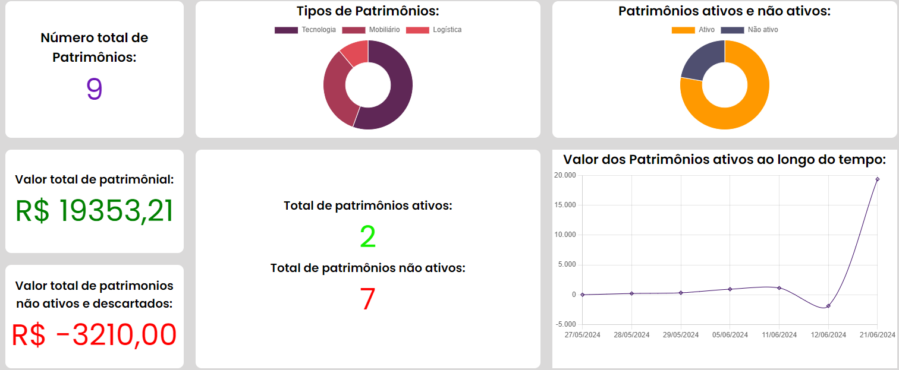
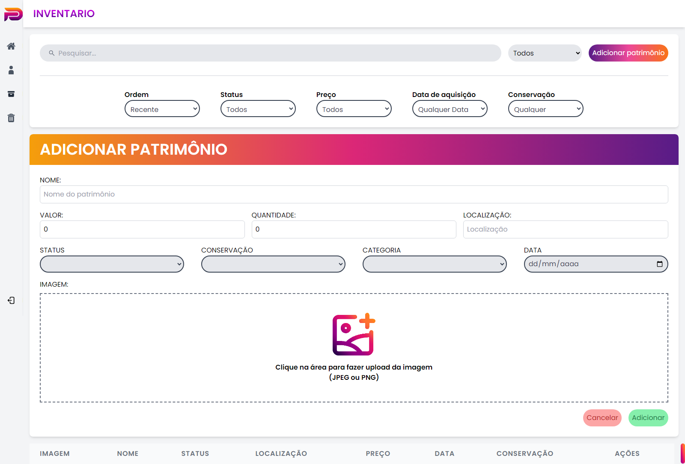
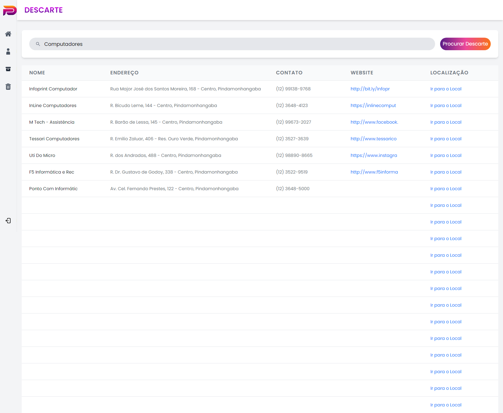

# Patrify - Sistema de Gestão Patrimonial 🏢

O **Patrify** é uma aplicação web completa desenvolvida para automatizar e otimizar a gestão patrimonial de empresas. O sistema oferece controle total sobre os ativos, desde o registro e monitoramento de depreciação até o descarte inteligente e ecologicamente correto.

Este projeto foi desenvolvido como Trabalho de Conclusão de Curso (TCC) em Análise e Desenvolvimento de Sistemas.

## 🚀 Funcionalidades

* **Dashboard Analítico:** Visão geral com a quantidade de patrimônios (ativos e inativos), valor total acumulado, gastos gerados por ativos inativos e um gráfico de evolução de valores ao longo do tempo.
* **Inventário Completo:** Tabela interativa para adicionar, editar e remover bens. Conta com barra de pesquisa e filtros avançados (ordem, status, preço, data de aquisição e estado de conservação).
* **Descarte Inteligente (Integração Google Maps API):** Facilita o descarte responsável de ativos. O usuário busca o tipo de material e o sistema localiza os pontos de descarte adequados mais próximos, fornecendo endereço, contato e rota no mapa.
* **Autenticação e Segurança Avançada:** 
  * Validação em tempo real de CNPJ via API externa no momento do cadastro.
  * Criptografia de senhas e recuperação de acesso via e-mail.
  * Proteção de rotas no back-end utilizando validação de tokens JWT (middleware `verifyToken`).

## 💻 Tecnologias Utilizadas

**Front-end:**
* Angular & TypeScript
* HTML5
* Estilização: Tailwind CSS, SCSS, SASS e animações com GSAP.

**Back-end:**
* Node.js & JavaScript
* Autenticação baseada em JWT (JSON Web Tokens)
* Arquitetura em camadas (Models, Controllers e Middlewares)

**Banco de Dados & Infraestrutura:**
* PostgreSQL (Linguagem SQL)
* Google Cloud (Armazenamento de imagens)
* Hospedagem front-end e back-end: Vercel

## 📸 Demonstração da Aplicação


*Visão geral do painel com gráficos de valores e status dos ativos.*


*Gestão de ativos com filtros e ordenação estruturada.*


*Busca de pontos de descarte utilizando a API do Google.*

## 🛠️ Como executar o projeto localmente

### Pré-requisitos
* Node.js instalado
* PostgreSQL configurado e rodando
* Angular CLI instalado globalmente (opcional, dependendo dos scripts)

### Passo a passo

1. **Clone o repositório:**
   ```bash
   git clone [https://github.com/Jm619353/patrify.git](https://github.com/Jm619353/patrify.git)
   ```

2. **Iniciando o Back-end:**
   ```bash
   cd patrify-backend
   npm install
   # Crie seu arquivo .env baseado no .env.example
   npm start
   ```

3. **Iniciando o Front-end:**
   ```bash
   cd ../patrify-frontend
   npm install
   npm start
   ```

## 👥 Equipe Desenvolvedora

- **Evertom Anderson Santos Godoy** - *Analista de Requisitos*
  [GitHub](https://github.com/link-do-evertom) | [LinkedIn](https://linkedin.com/in/link-do-evertom)

- **Guilherme Ferraz Macedo** - *QA / Dev Back-end*
  [GitHub](https://github.com/link-do-guilherme) | [LinkedIn](https://linkedin.com/in/link-do-guilherme)

- **João Miguel Freitas da Silva Santos** - *Desenvolvedor de Banco de Dados / Dev Backend*
  [GitHub](https://github.com/Jm619353) | [LinkedIn](https://www.linkedin.com/in/joaomiguel-santos/)

- **Kevin Willians Monteiro Silva** - *Integração de API / Dev FullStack*
  [GitHub](https://github.com/kevinsilvacyber) | [LinkedIn](https://www.linkedin.com/in/kevin-willians-monteiro-silva-0b096622b/)

- **Maylon Fernandes da Silva** - *Designer de Interface / Dev Frontend*
  [GitHub](https://github.com/maylon-fernandes) | [LinkedIn](https://linkedin.com/in/link-do-maylon)